Atomic physics was an undergrad lecture jointly held by [Prof. Klaus Sengstock](https://physik.uni-hamburg.de/en/ilp/sengstock/personen/sengstock) and [Prof. Henning Moritz](https://physik.uni-hamburg.de/en/ilp/moritz/personen/moritz).

Below are solutions to the exercise sheets as well as the final exam. Fair warning though, it's all in German.

## Exam Preparation

[Mock exam 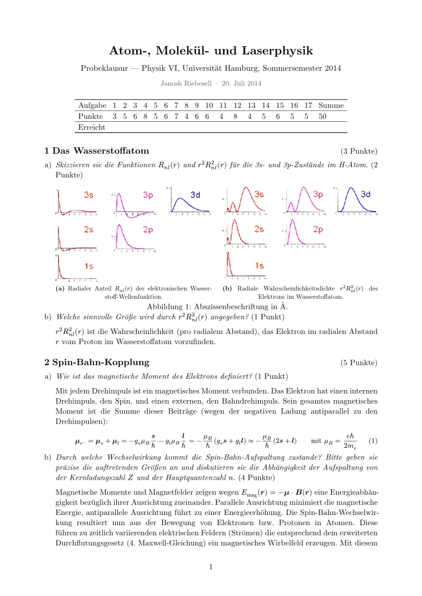](./pdfs/mock-exam.pdf)

## Exercises

[Exercise 1 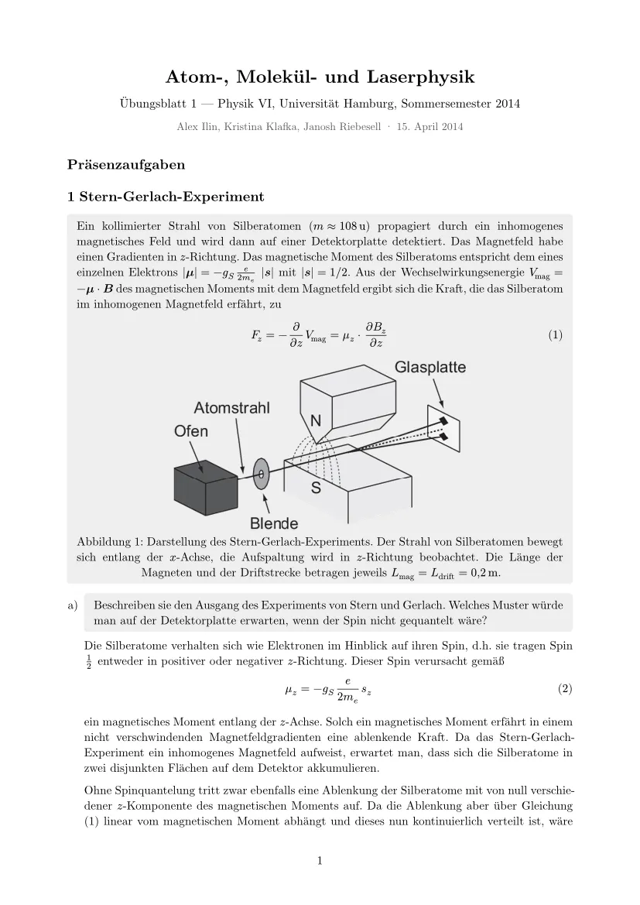](./pdfs/solution-01.pdf)

[Exercise 2 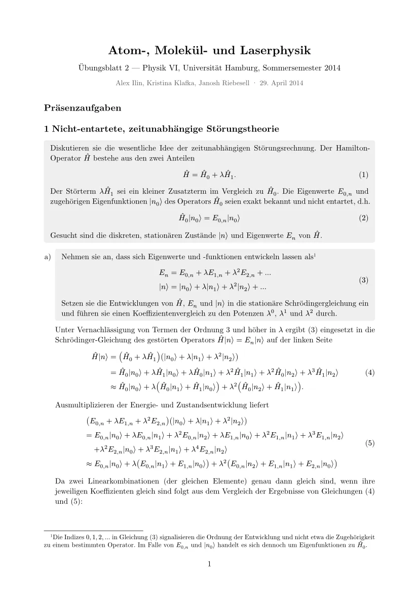](./pdfs/solution-02.pdf)

[Exercise 3 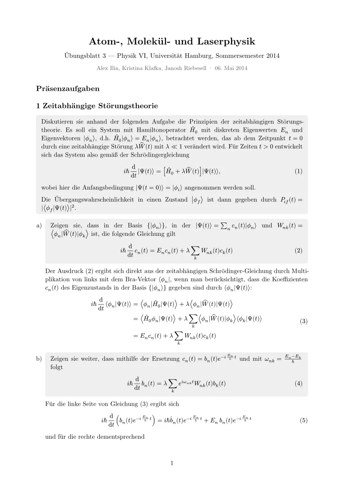](./pdfs/solution-03.pdf)

[Exercise 4 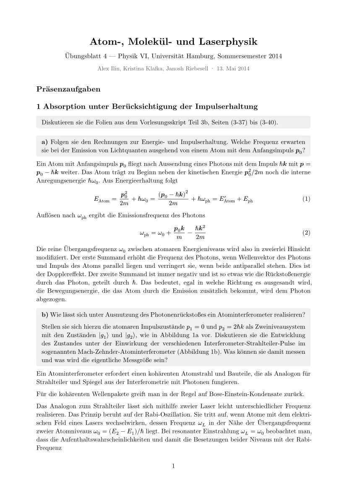](./pdfs/solution-04.pdf)

[Exercise 5 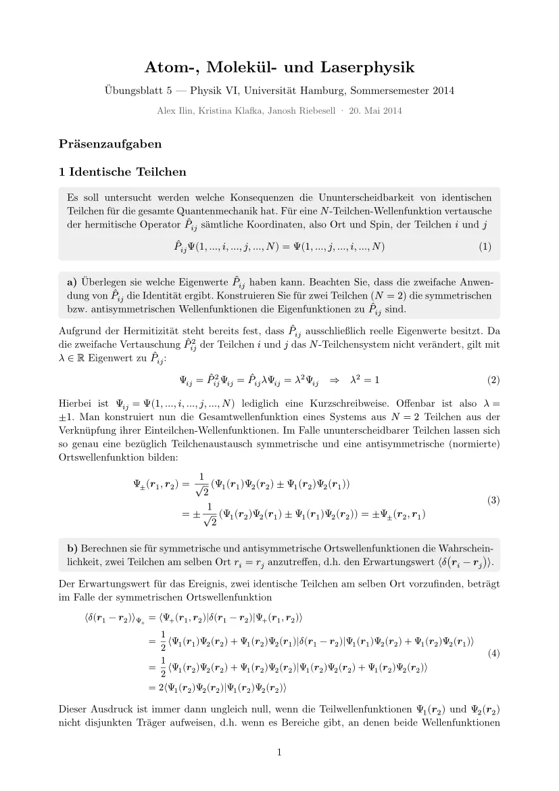](./pdfs/solution-05.pdf)

[Exercise 6 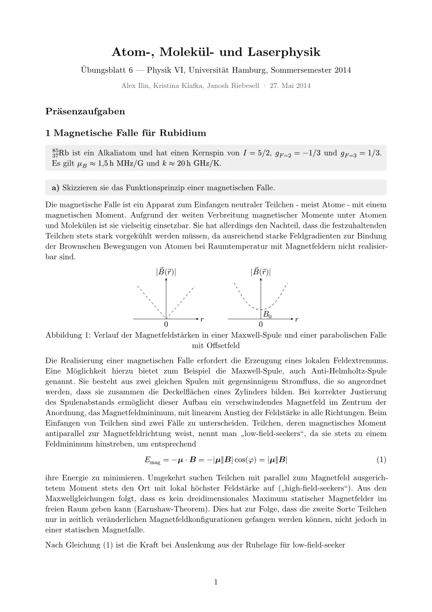](./pdfs/solution-06.pdf)

[Exercise 7 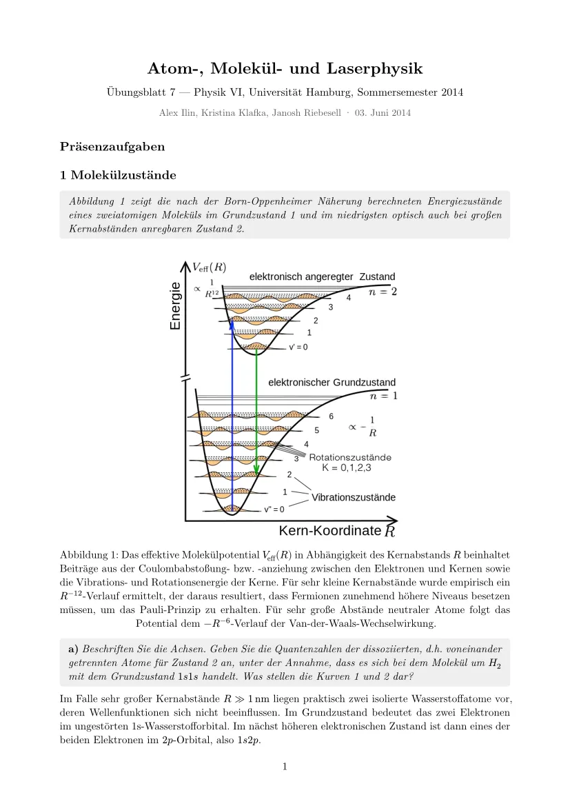](./pdfs/solution-07.pdf)

[Exercise 8 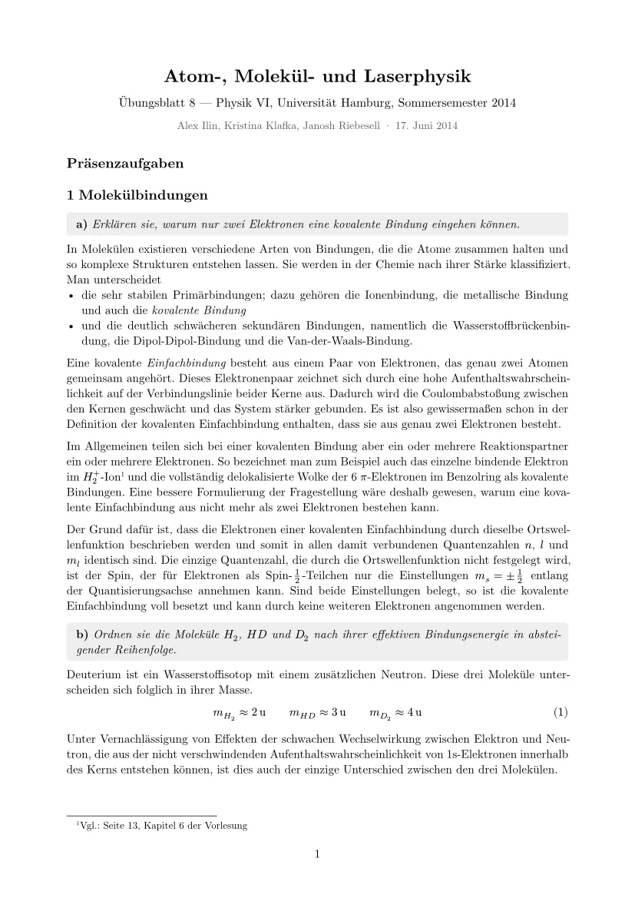](./pdfs/solution-08.pdf)

[Exercise 9 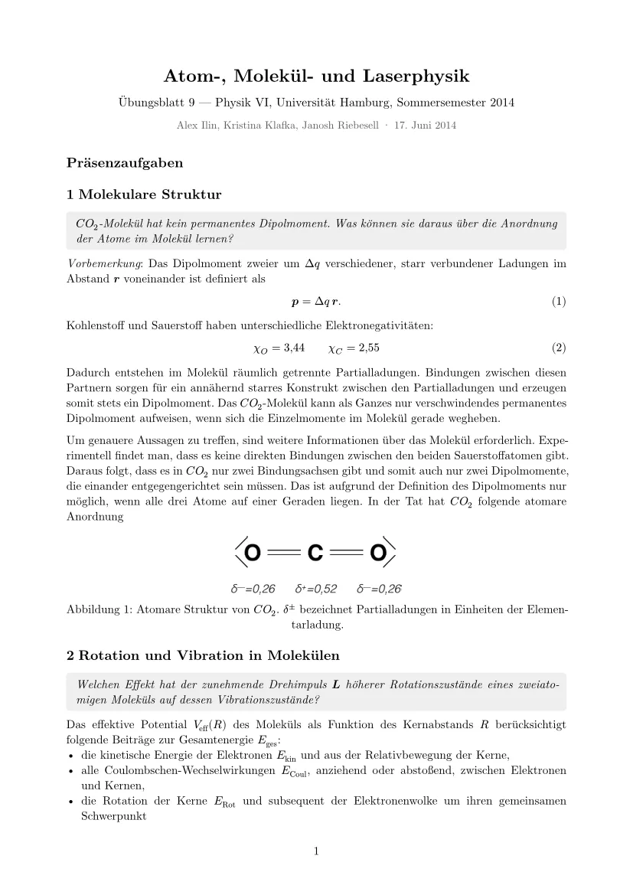](./pdfs/solution-09.pdf)

[Exercise 10 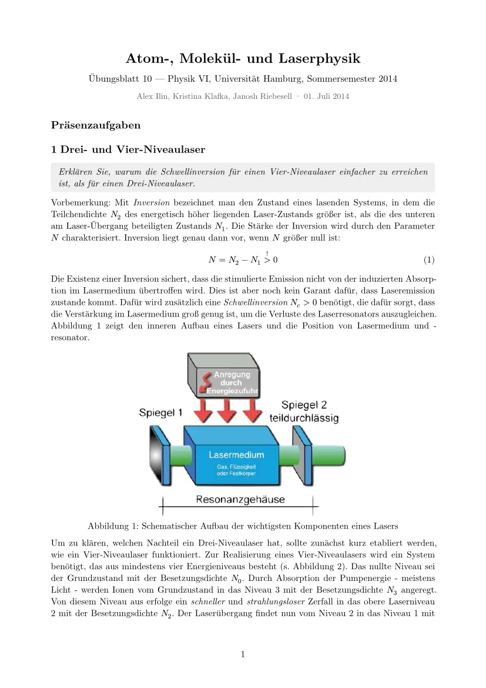](./pdfs/solution-10.pdf)

