In the summer of 2015, [Prof. Daniel Roggenkamp](https://www.thphys.uni-heidelberg.de/~roggenkamp) gave a small but insightful lecture on group theory and its applications in physics at [Heidelberg University](https://www.uni-heidelberg.de/en).

Below are lecture notes and solutions to the exercises.

## Lecture notes

[Lecture 1 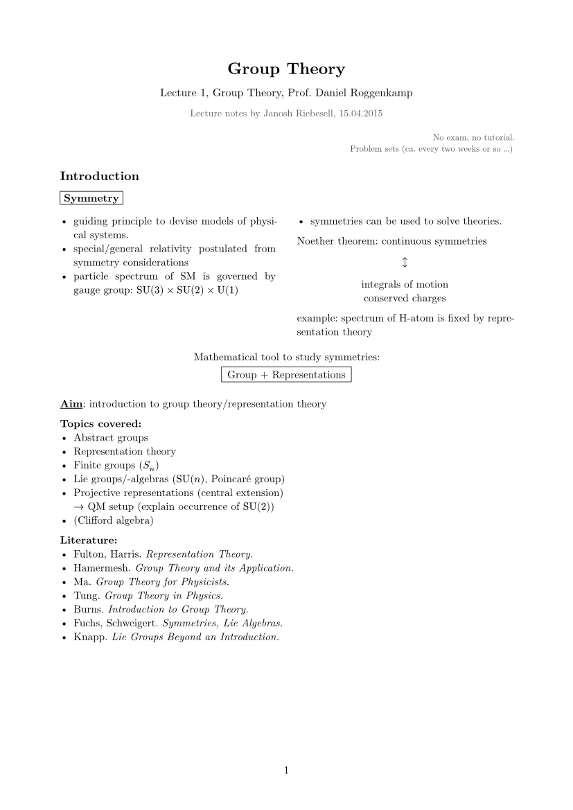](./pdfs/lecture-01.pdf)

[Lecture 2 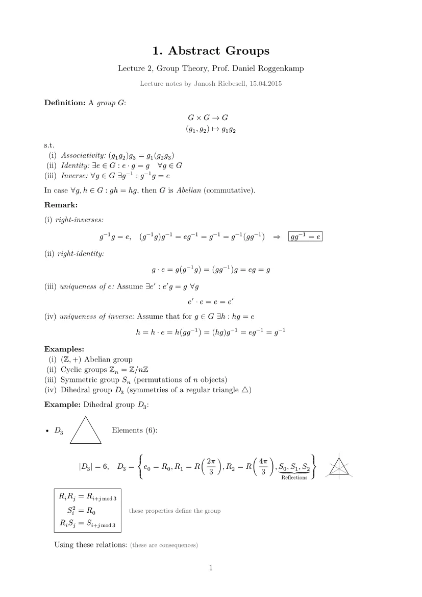](./pdfs/lecture-02.pdf)

[Lecture 3 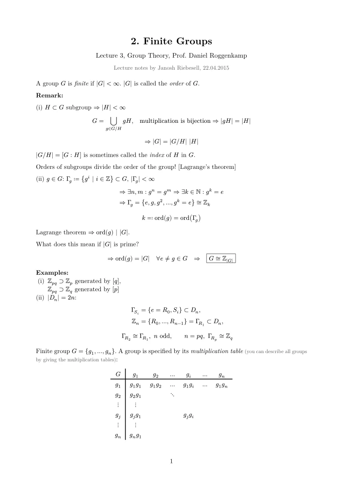](./pdfs/lecture-03.pdf)

[Lecture 4 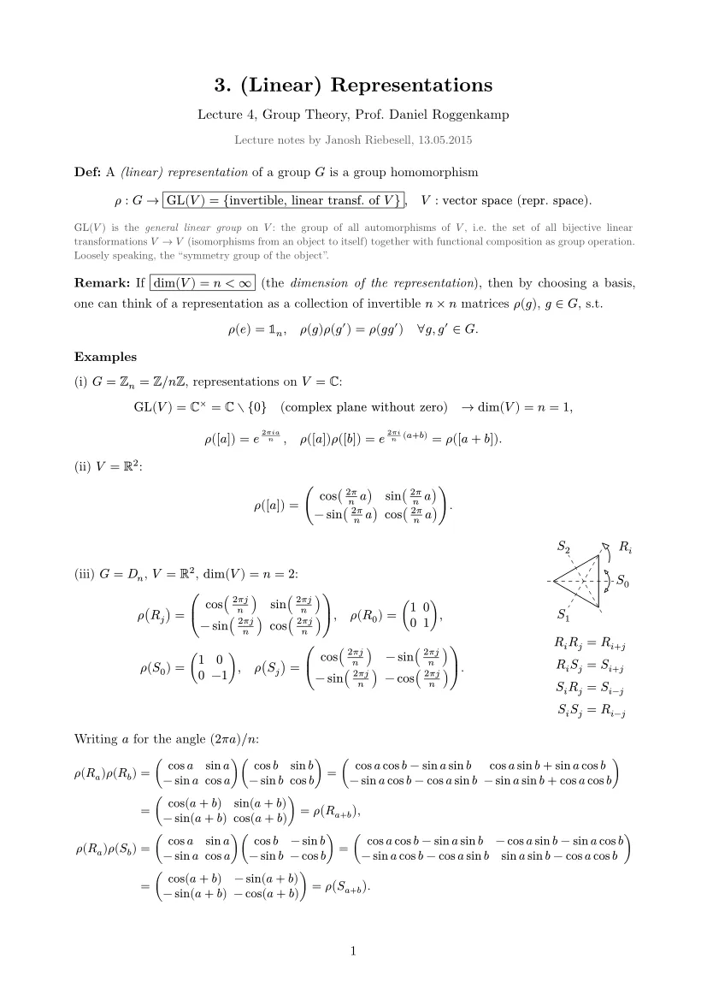](./pdfs/lecture-04.pdf)

[Lecture 5 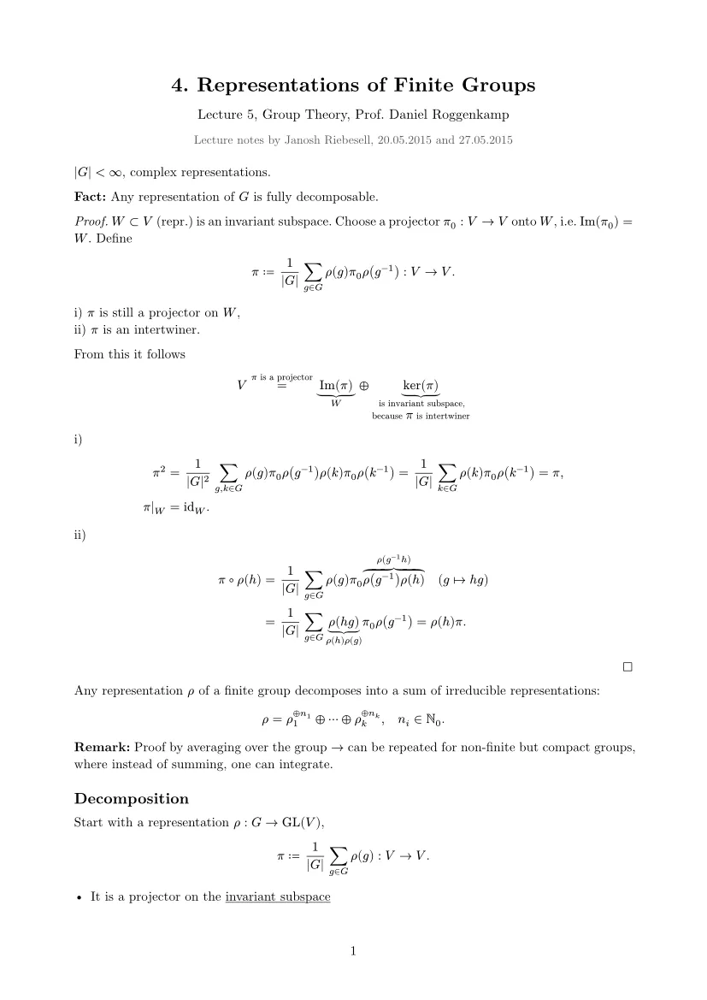](./pdfs/lecture-05.pdf)

[Lecture 6 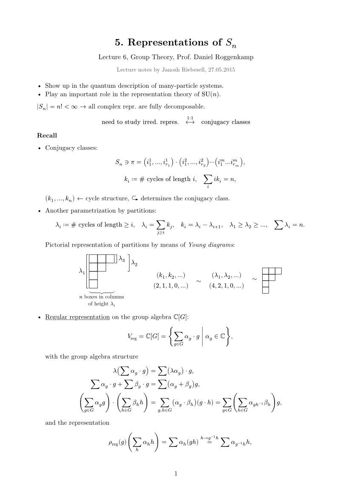](./pdfs/lecture-06.pdf)

[Lecture 7 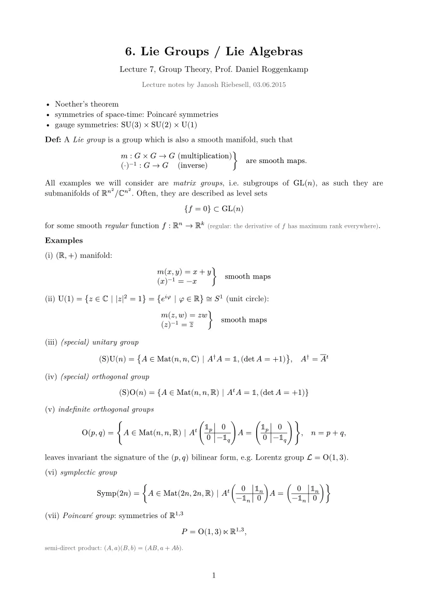](./pdfs/lecture-07.pdf)

[Lecture 8 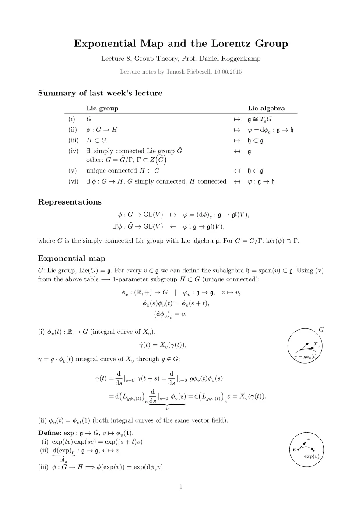](./pdfs/lecture-08.pdf)

## Exercises

[Exercise 1 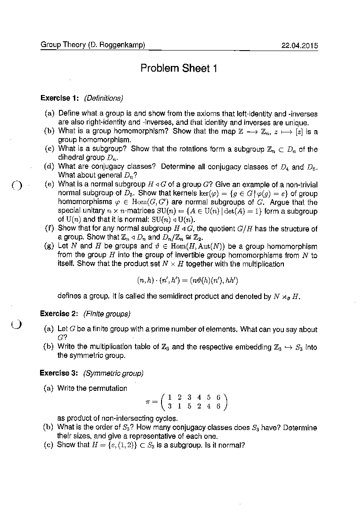](./pdfs/exercise-01.pdf)

[Exercise 2 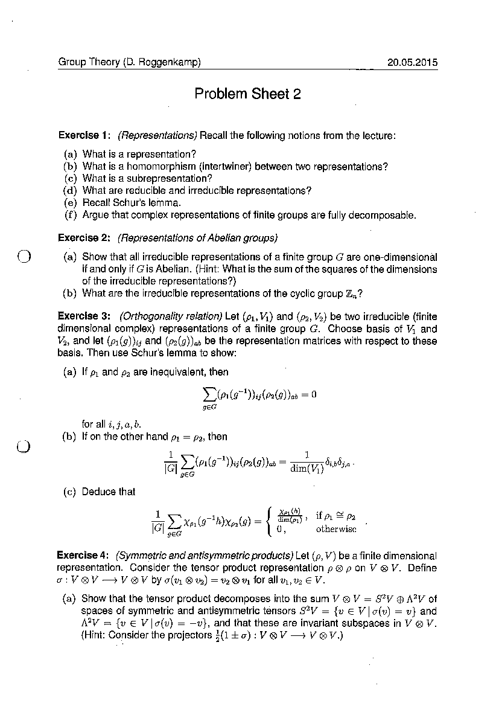](./pdfs/exercise-02.pdf)

[Exercise 3 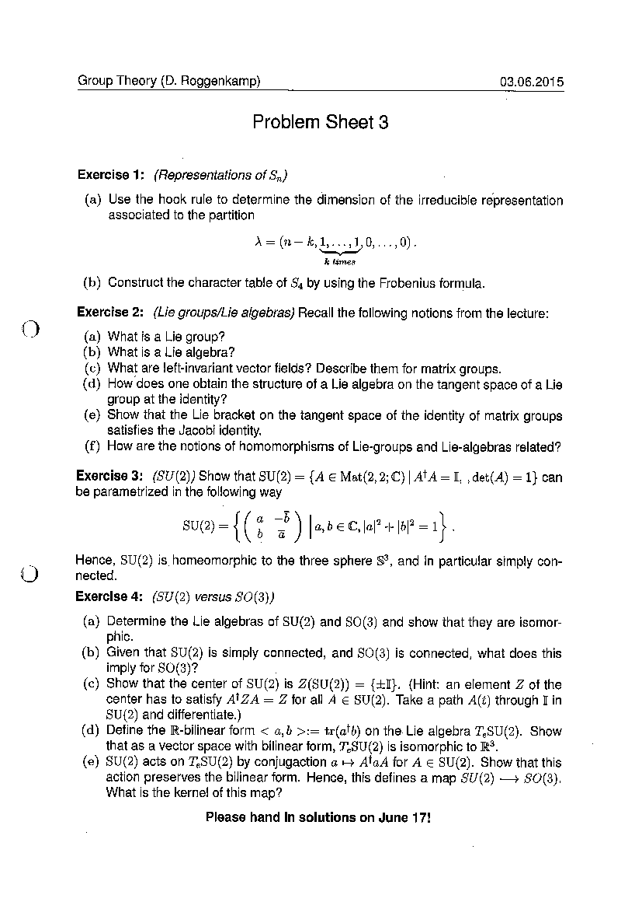](./pdfs/exercise-03.pdf)

[Solution 1 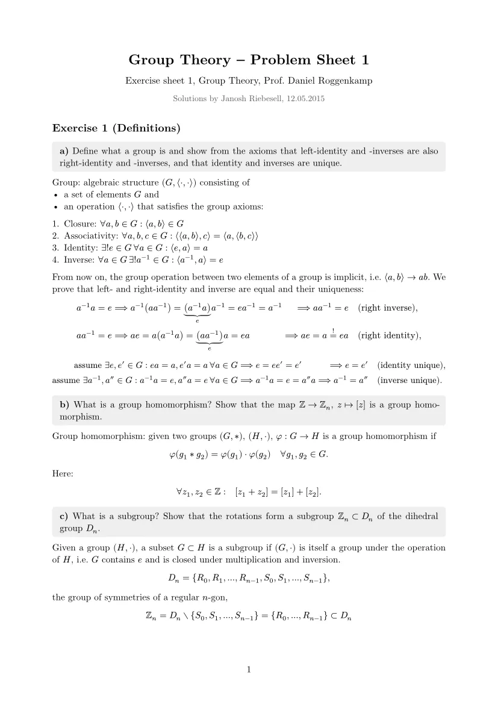](./pdfs/solution-01.pdf)

[Solution 2 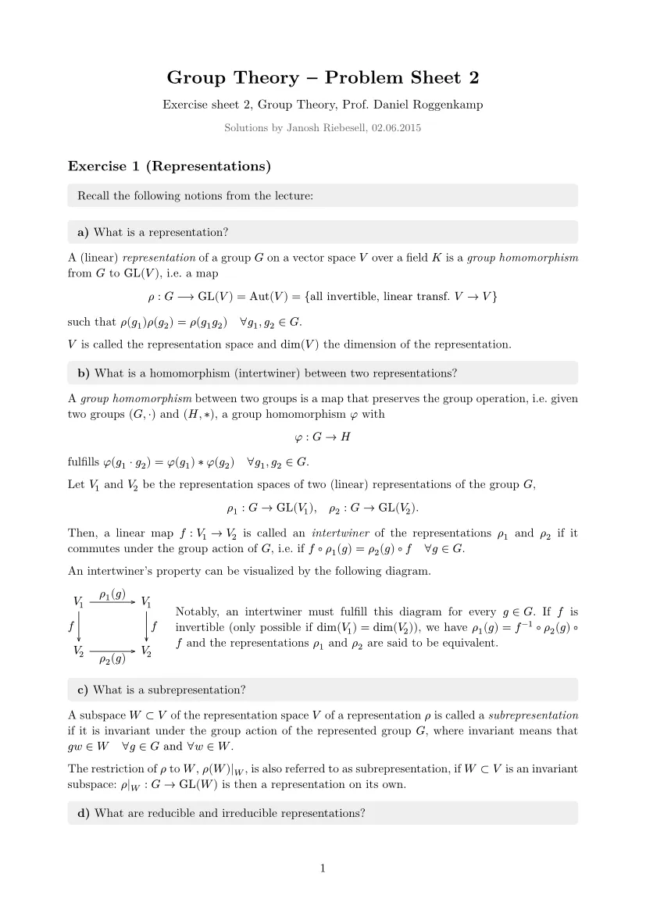](./pdfs/solution-02.pdf)

[Solution 3 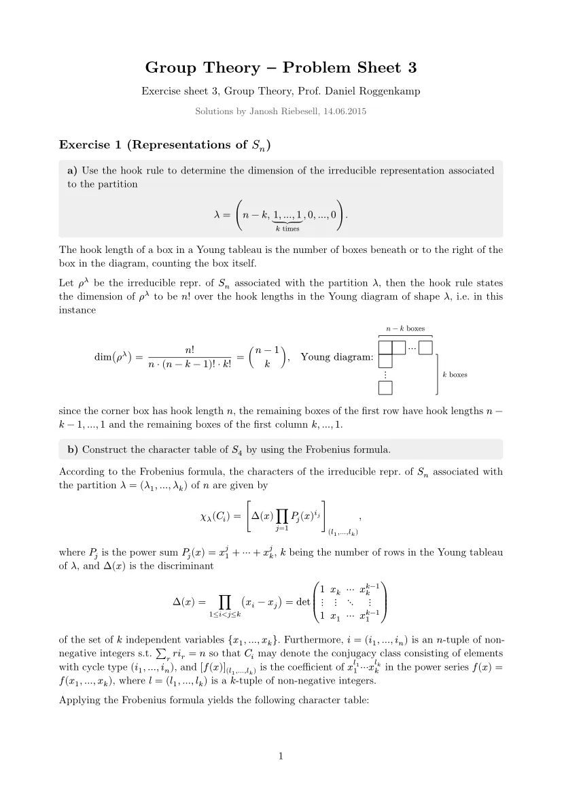](./pdfs/solution-03.pdf)

