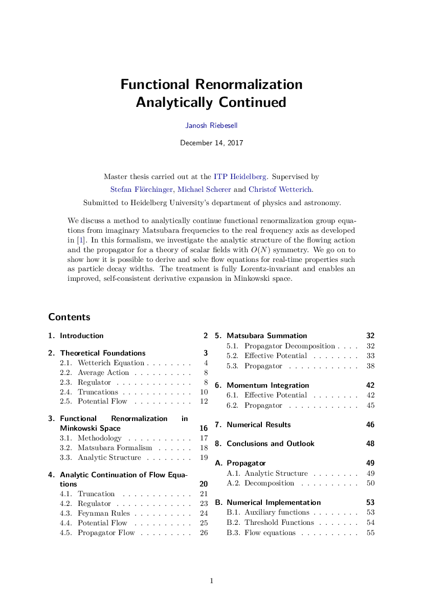

I wrote my master's thesis under the supervision of [Stefan Flörchinger](https://www.thphys.uni-heidelberg.de/~floerchinger), [Michael Scherer](https://www.physik.ruhr-uni-bochum.de/en/Professuren/prof-dr-scherer-michael/) and [Christof Wetterich](https://www.thphys.uni-heidelberg.de/~wetterich) at [ITP Heidelberg](https://www.thphys.uni-heidelberg.de/).

## Topic

[Functional renormalization group](/posts/what-is-renormalization) equations are analytically continued from imaginary Matsubara frequencies to the real frequency axis. In this formalism, we investigate the analytic structure of the flowing action and the propagator for a theory of scalar fields with $O(N)$ symmetry. We go on to show how it is possible to derive and solve flow equations for real-time properties such as particle decay widths. The treatment is fully Lorentz-invariant and enables an improved, self-consistent derivative expansion in Minkowski space.

[Thesis ](./thesis.pdf)

