[Numerical Simulations](https://www.h-its.org/2014/11/10/lecture-fundamentals-of-simulation-methods/) was a particularly enjoyable course given by [Prof. Volker Springel](https://www.imprs-astro.mpg.de/content/prof-dr-volker-springel) in the winter term 2015/16 at [Heidelberg University](https://www.uni-heidelberg.de/en).

Below are solutions to all the exercises as well as to the mock and the final exam.

The corresponding codes can be found in [this repo](https://github.com/janosh/numeric-simulations).

## Exam

[Exam solution 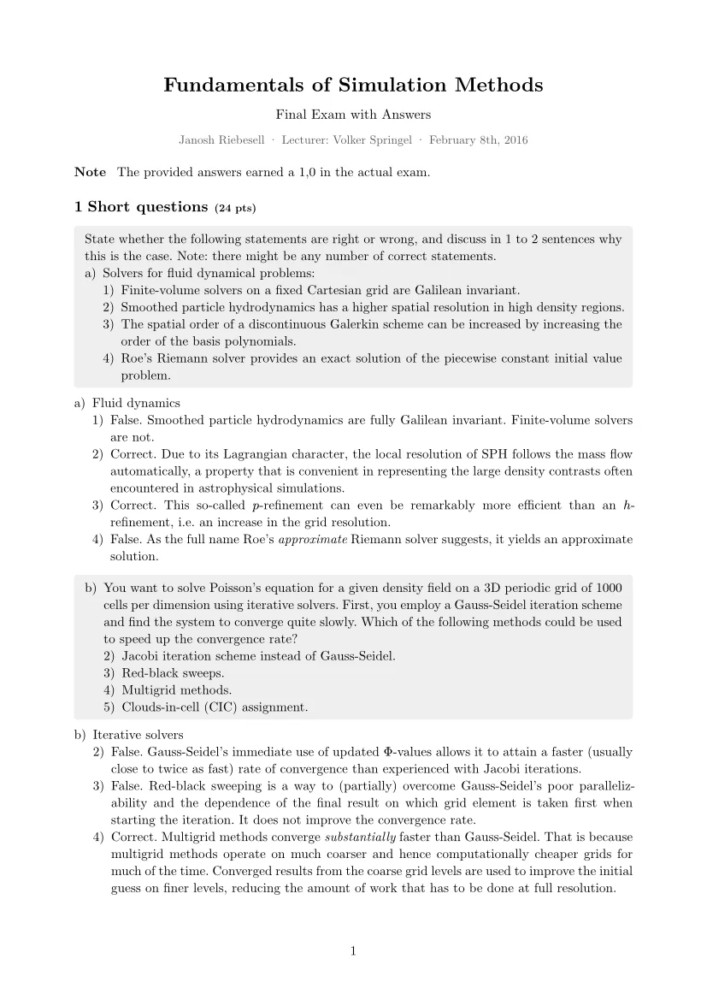](./pdfs/exam-solution.pdf)

[Practice exam solution 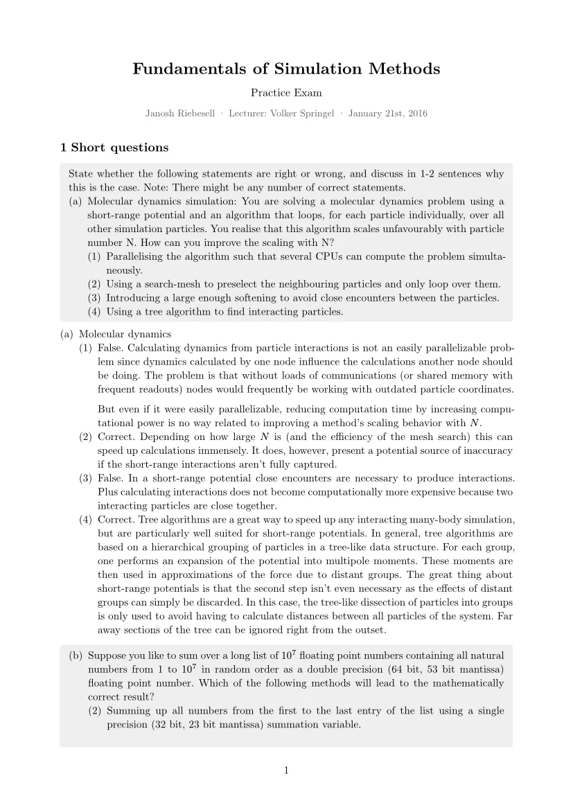](./pdfs/practice-exam-solution.pdf)

[Exam sheet 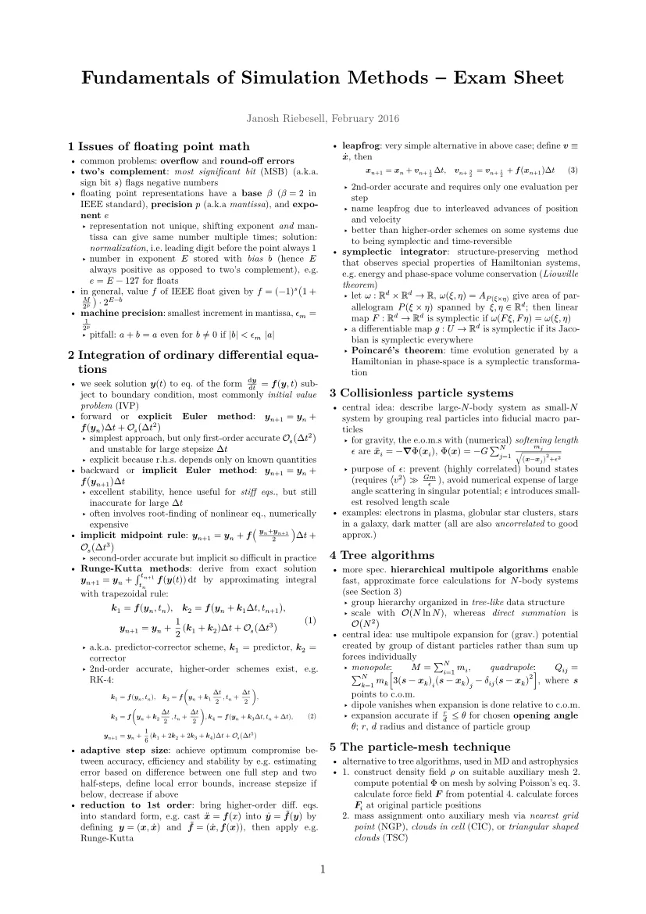](./pdfs/exam-sheet.pdf)

## Exercises

[Exercise 1 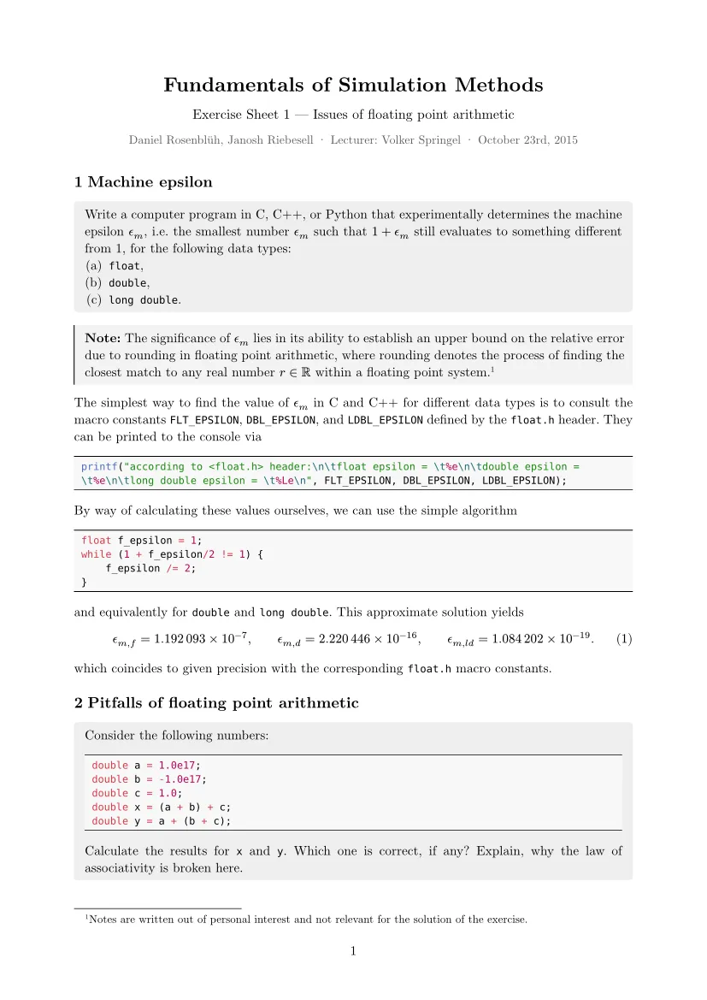](./pdfs/solution-01.pdf)

[Exercise 2 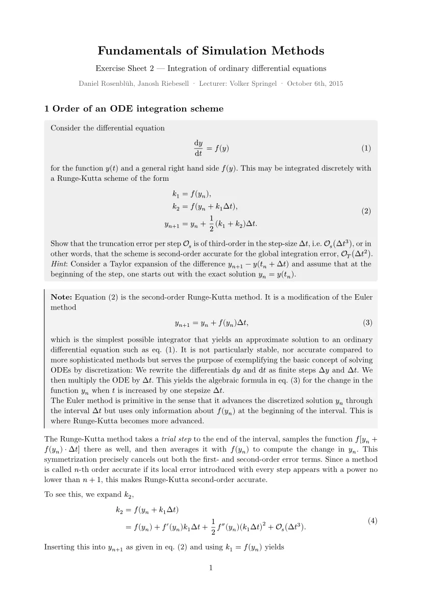](./pdfs/solution-02.pdf)

[Exercise 3 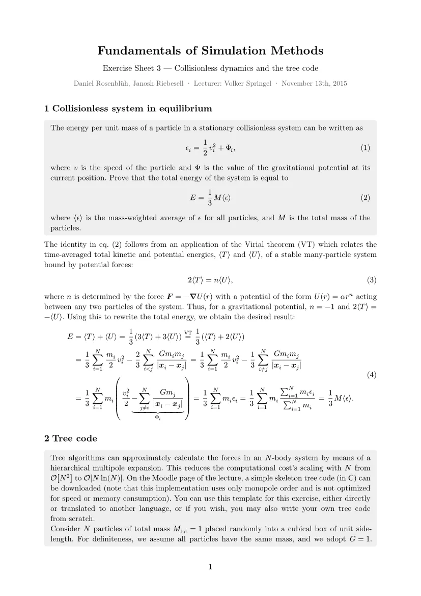](./pdfs/solution-03.pdf)

[Exercise 4 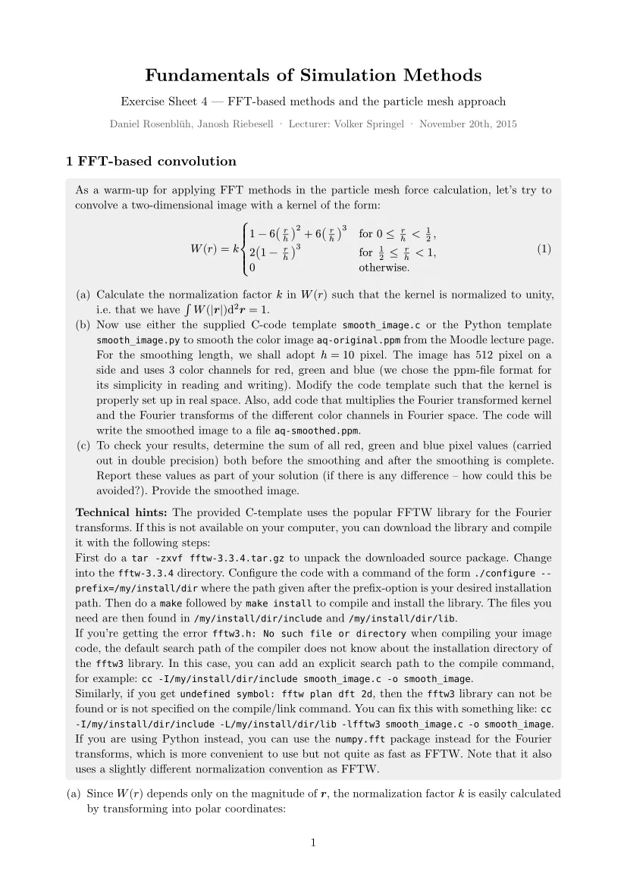](./pdfs/solution-04.pdf)

[Exercise 5 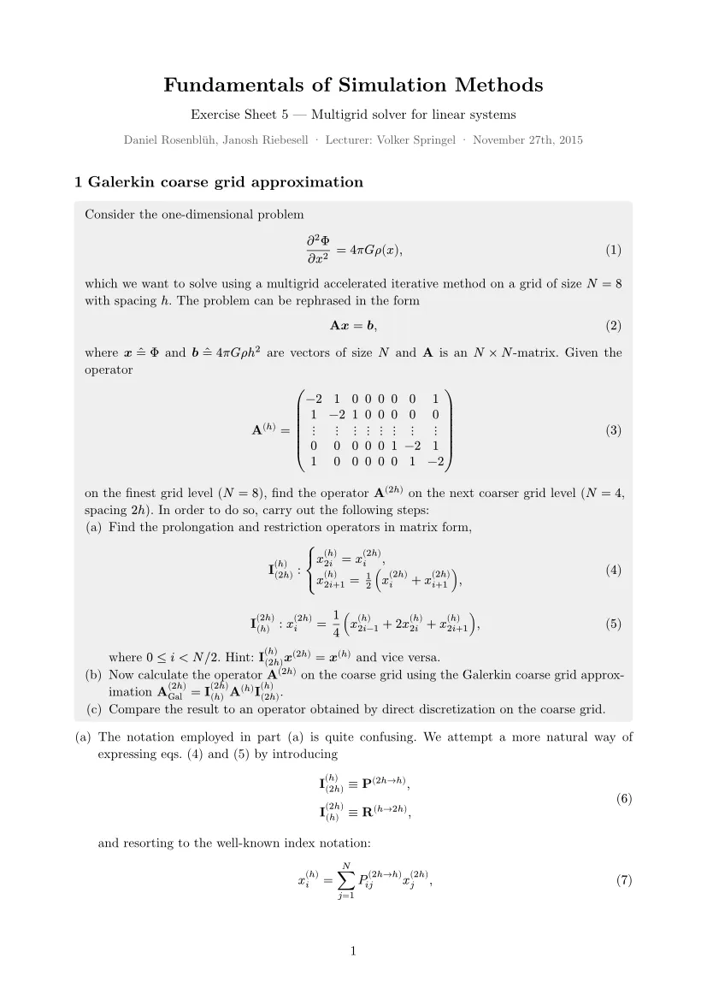](./pdfs/solution-05.pdf)

[Exercise 6 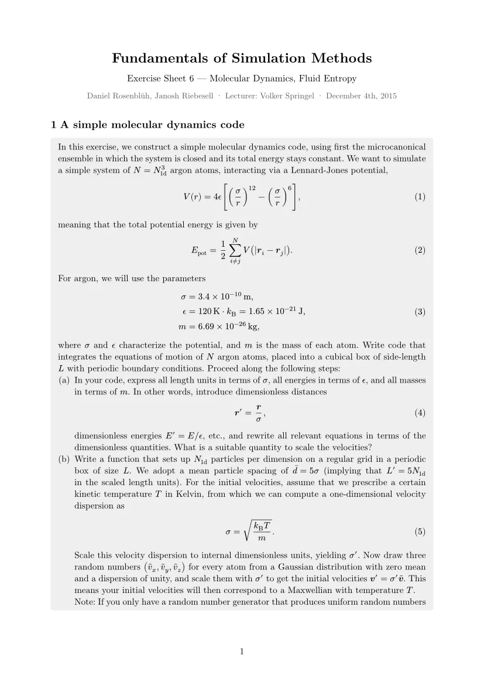](./pdfs/solution-06.pdf)

[Exercise 7 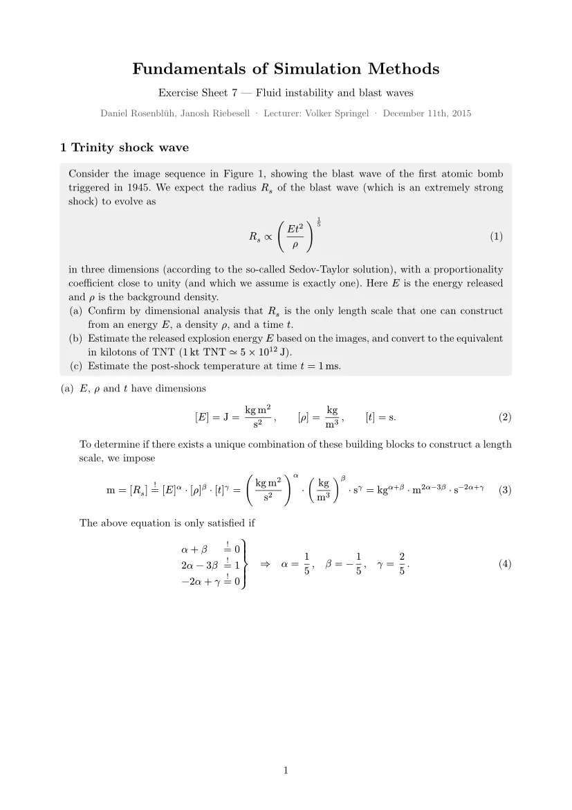](./pdfs/solution-07.pdf)

[Exercise 8 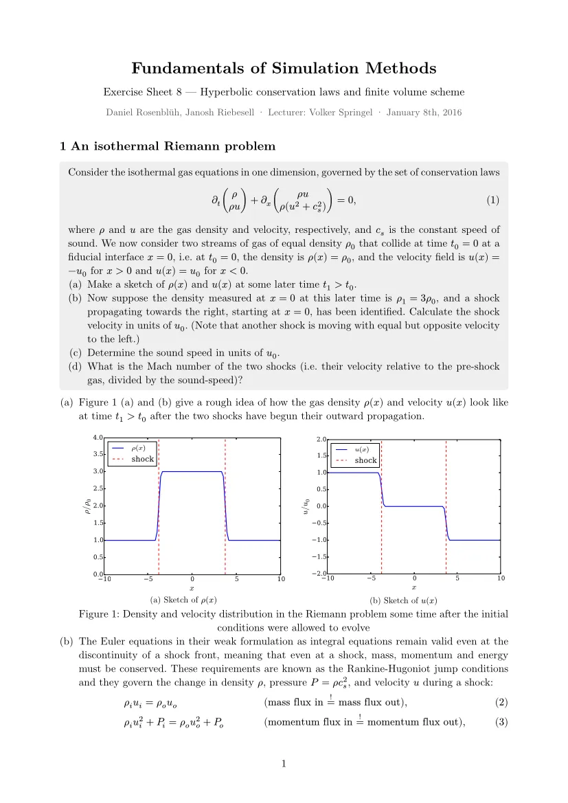](./pdfs/solution-08.pdf)

[Exercise 9 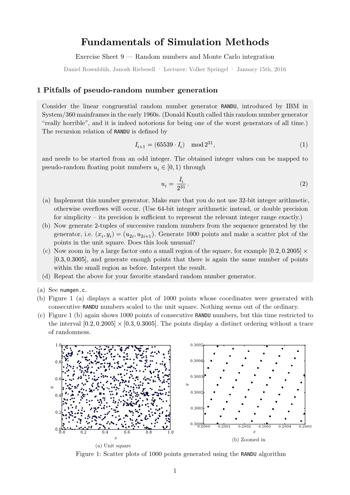](./pdfs/solution-09.pdf)

[Exercise 10 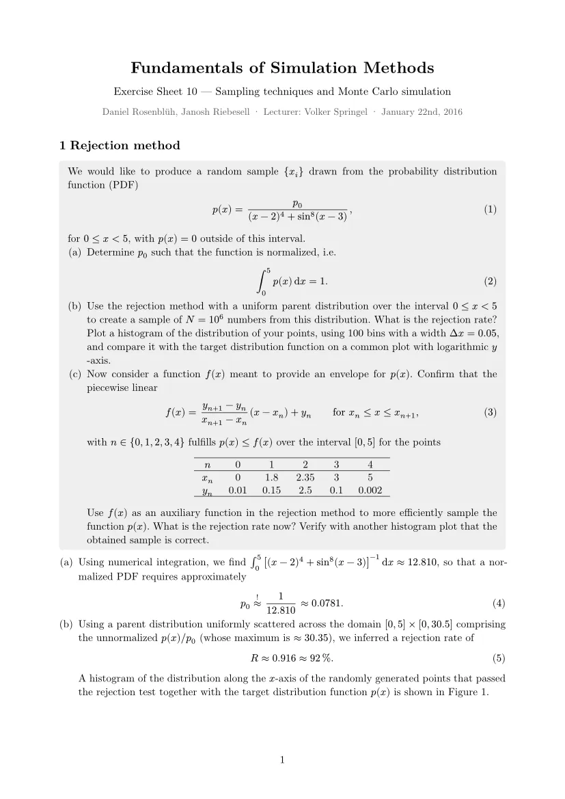](./pdfs/solution-10.pdf)

