This is a collection of mock exams with my solutions and exercise as well as lecture revisions I used to prepare for the exam in [QFT I](https://www.thphys.uni-heidelberg.de/~berges/teaching.htm). The lecture was given by [Prof. Jürgen Berges](https://www.thphys.uni-heidelberg.de/~berges/people.htm) at [Heidelberg University](https://www.uni-heidelberg.de/en) in the winter of 2014/15.

## Exam material

[Berges midterm exam 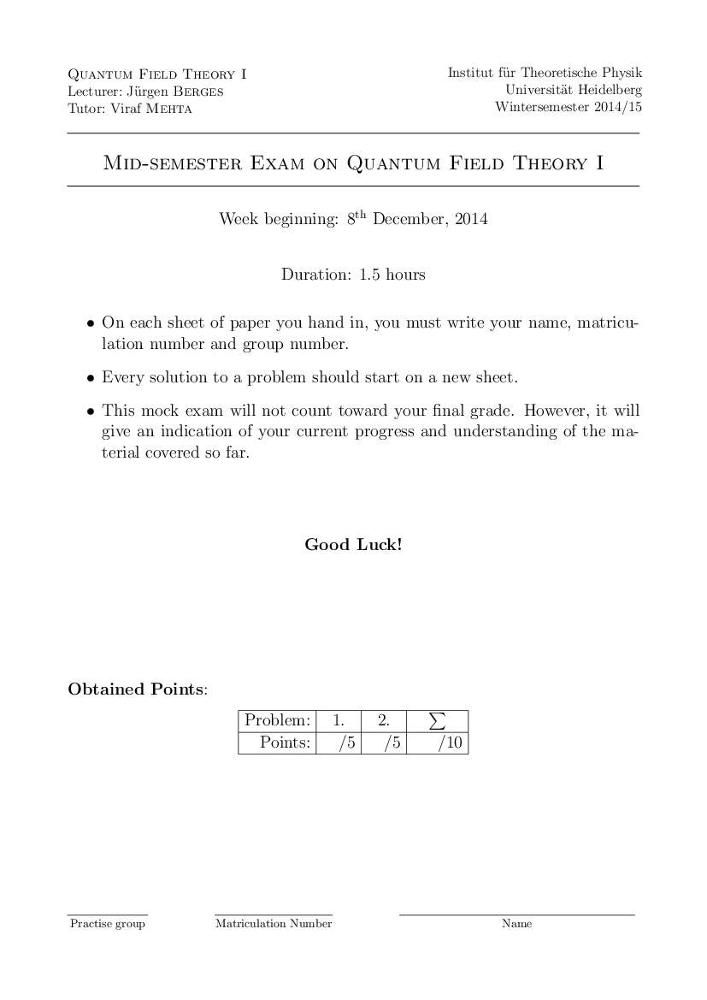](./pdfs/berges-midterm-exam.pdf)

[Berges midterm solution 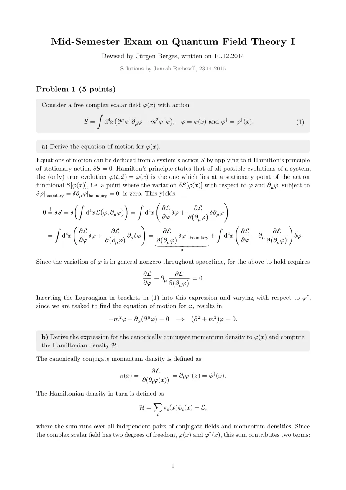](./pdfs/berges-midterm-solution.pdf)

[Bies model exam 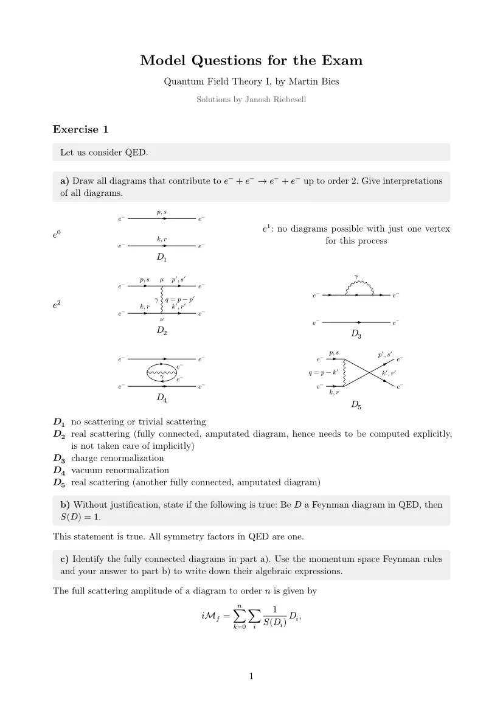](./pdfs/bies-model-exam.pdf)

[Exercise revision 1 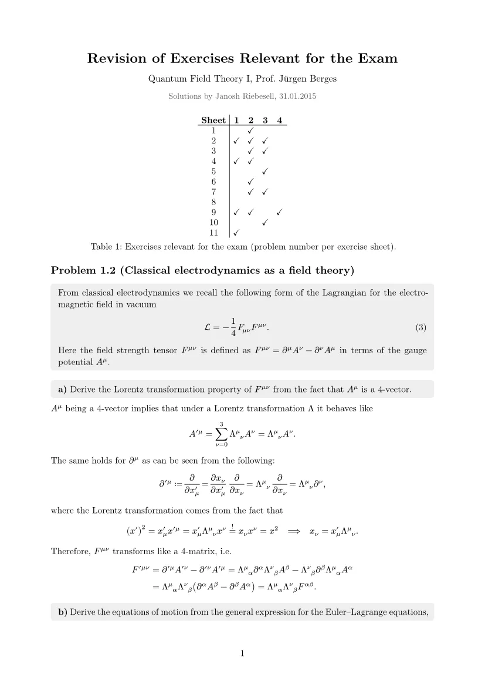](./pdfs/exercise-revision-1.pdf)

[Exercise revision 2 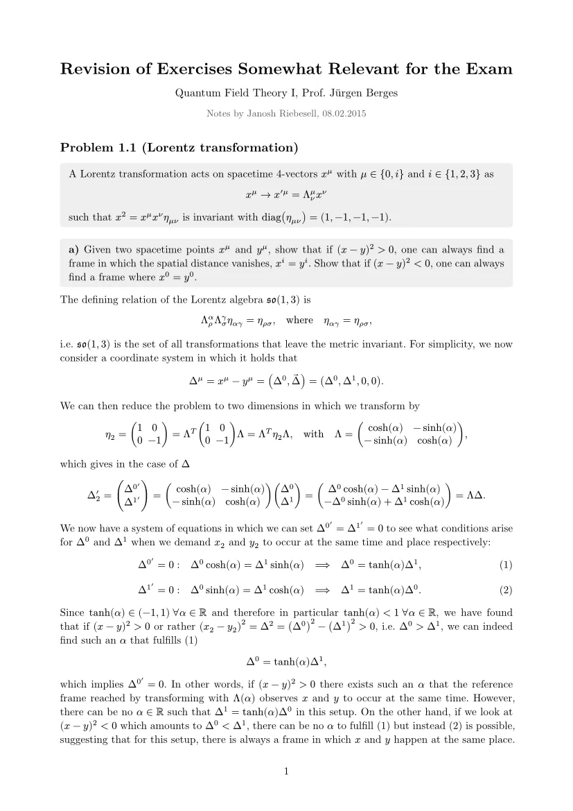](./pdfs/exercise-revision-2.pdf)

[Imperial college exam 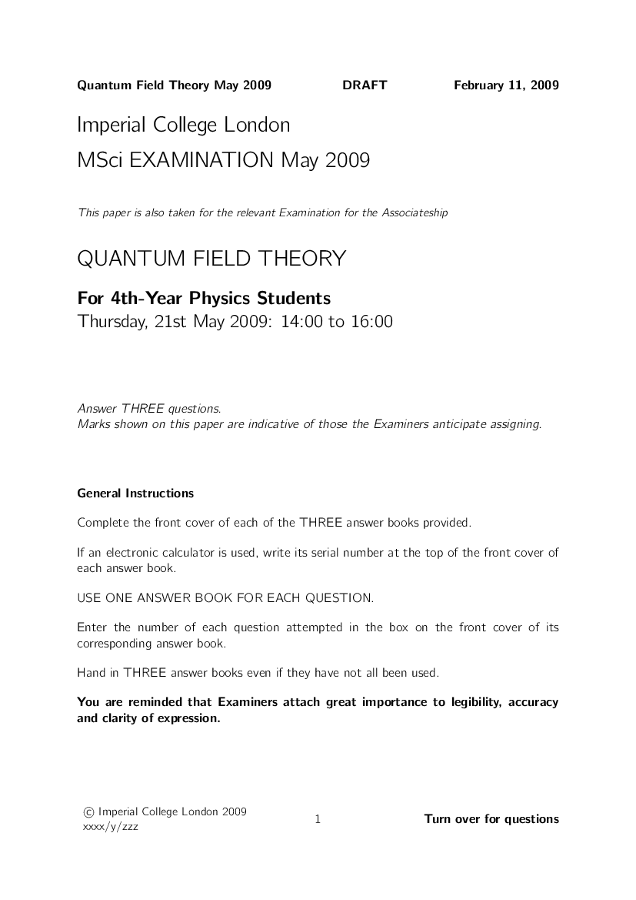](./pdfs/imperial-college-exam.pdf)

[Imperial college solution 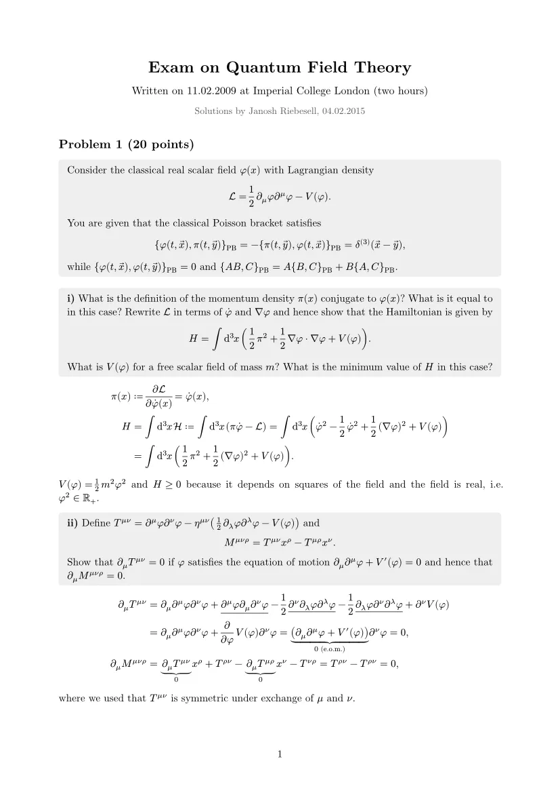](./pdfs/imperial-college-solution.pdf)

[Lecture revisions 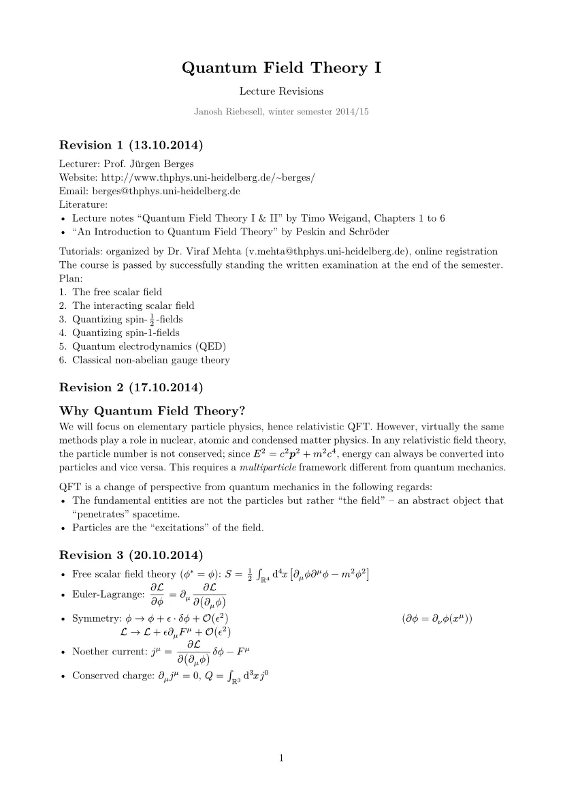](./pdfs/lecture-revisions.pdf)

[Plehn exam 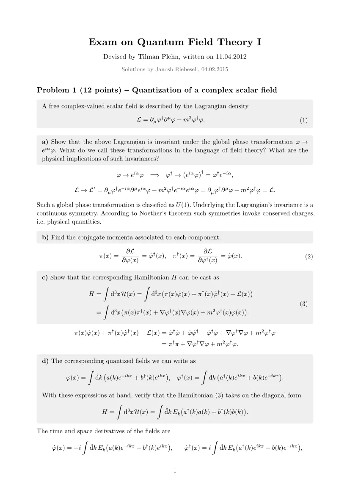](./pdfs/plehn-exam.pdf)

[Weigand exam 1 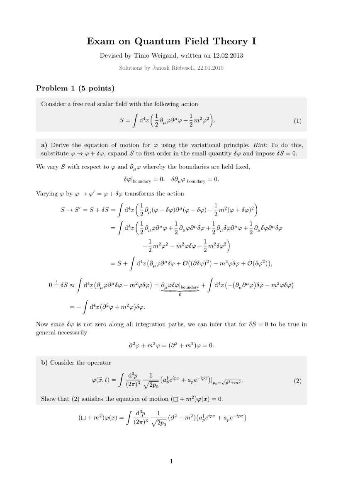](./pdfs/weigand-exam-1.pdf)

[Weigand exam 2 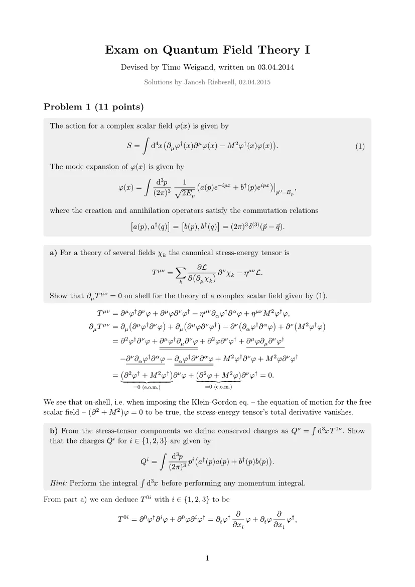](./pdfs/weigand-exam-2.pdf)

