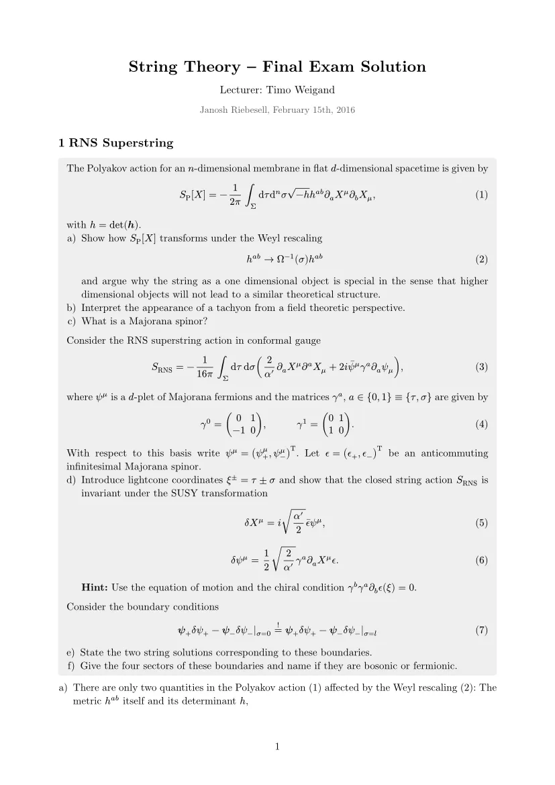
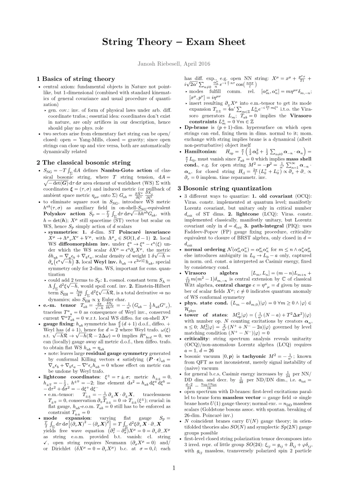
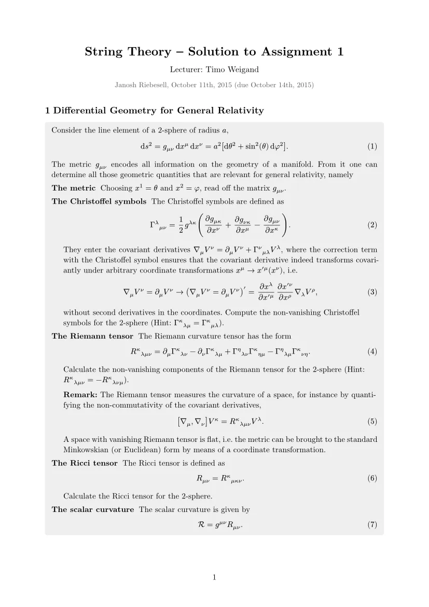
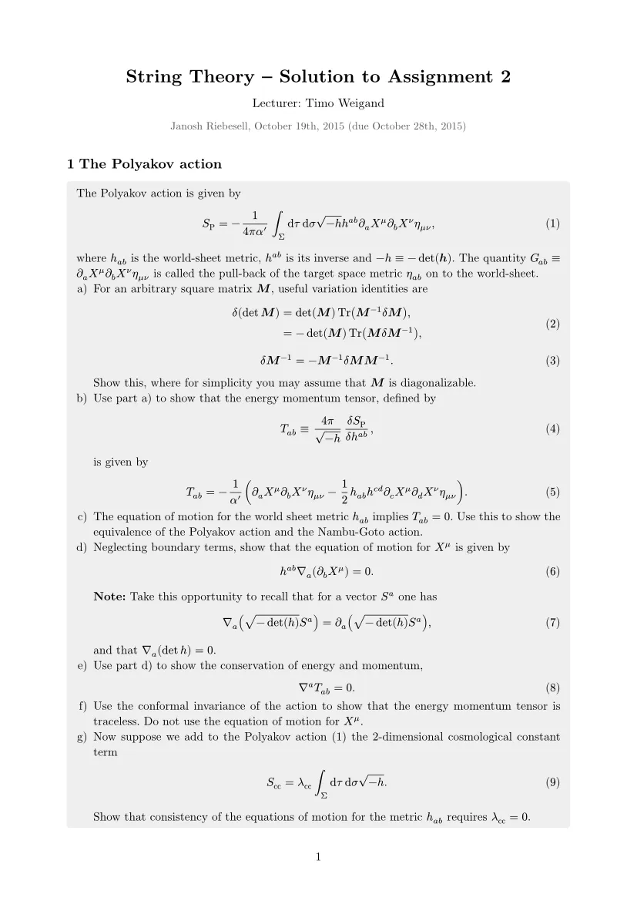
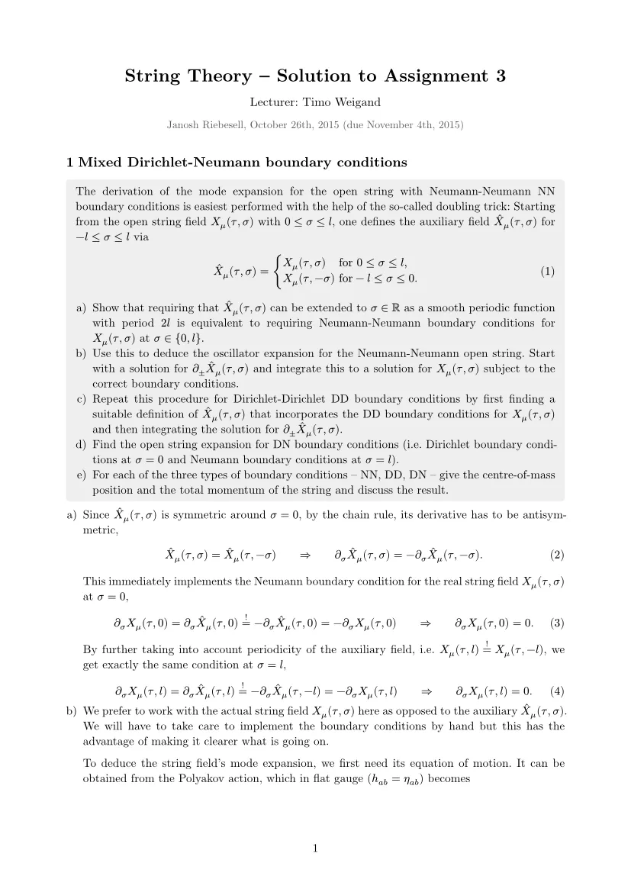
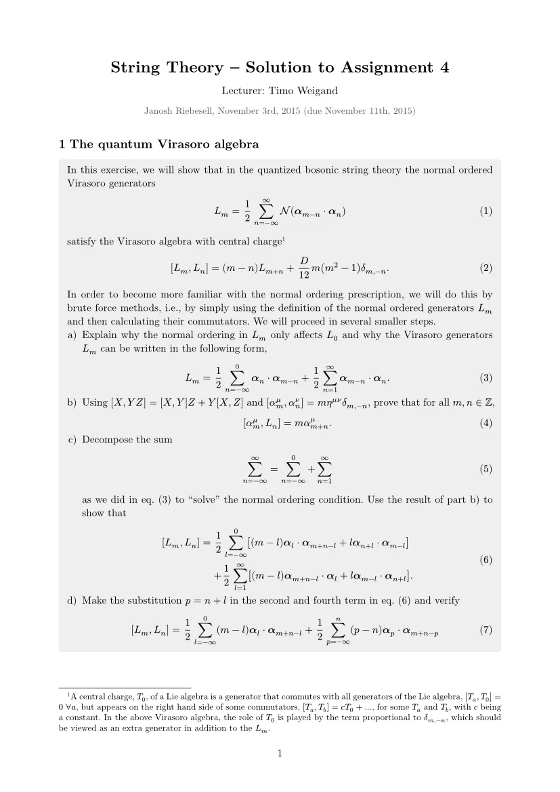
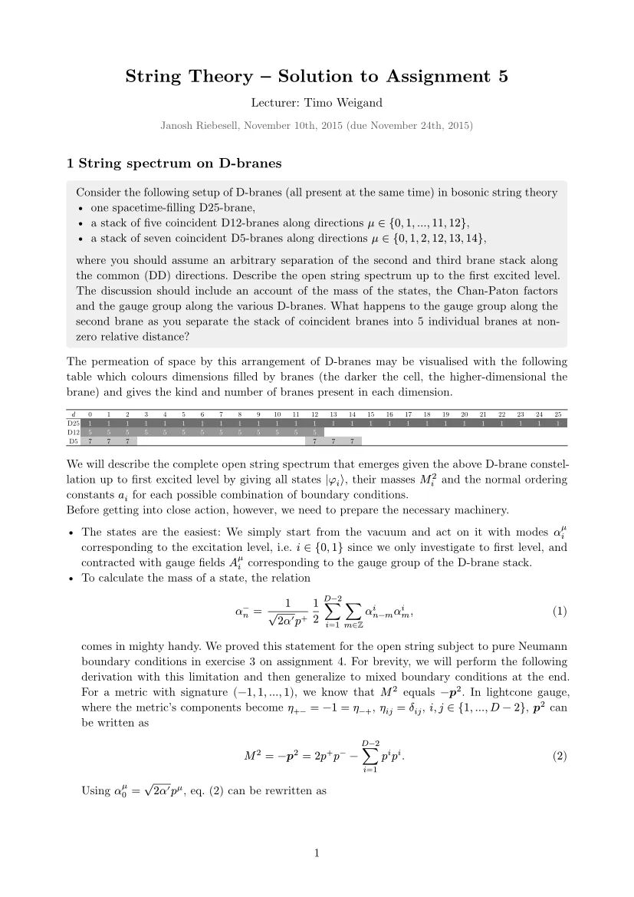
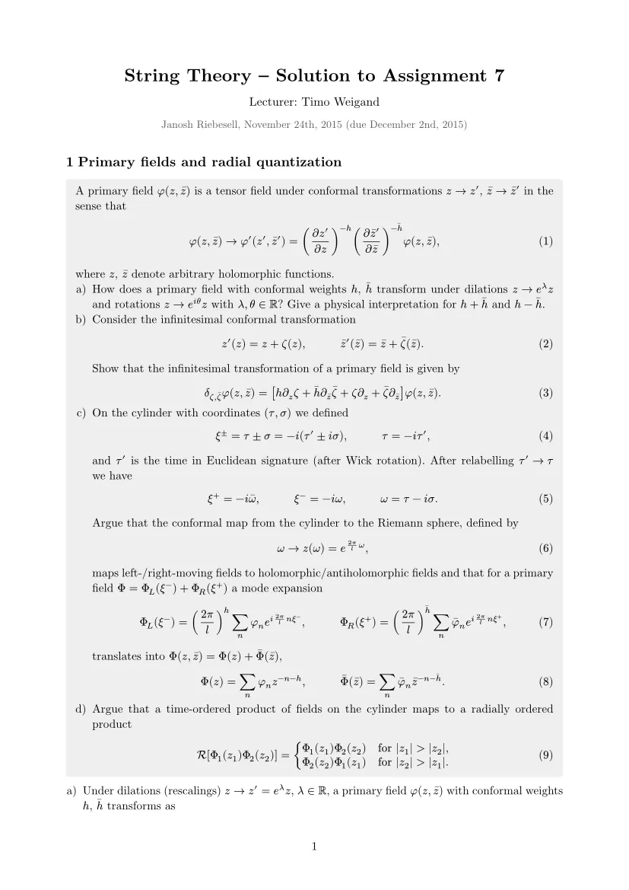
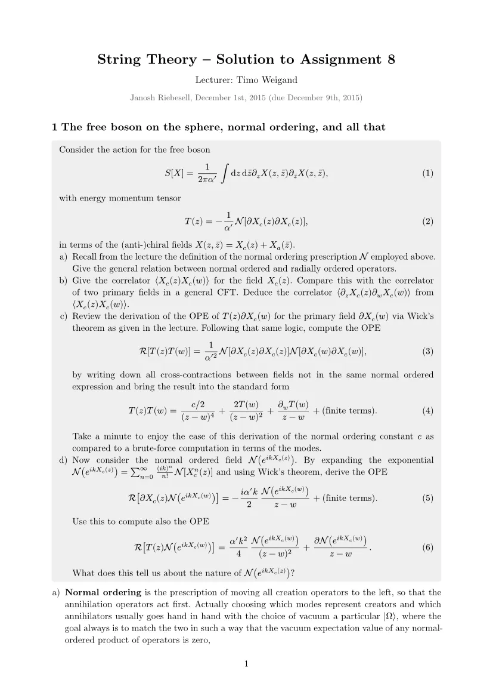
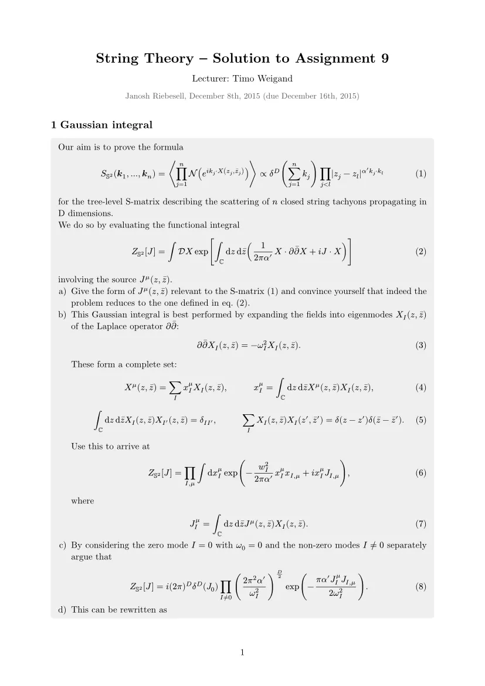

My notes and solutions for the final exam and the exercises handed out in the string theory lecture read by [Prof. Timo Weigand](https://qu.uni-hamburg.de/cluster/team/weigand.html) at [Heidelberg University](https://www.uni-heidelberg.de/en) in the winter semester of 2015/16.

## Exam

[Exam solution ](./pdfs/exam-solution.pdf)

[Exam sheet ](./pdfs/exam-sheet.pdf)

## Exercises

[Exercise 1 ](./pdfs/solution-01.pdf)

[Exercise 2 ](./pdfs/solution-02.pdf)

[Exercise 3 ](./pdfs/solution-03.pdf)

[Exercise 4 ](./pdfs/solution-04.pdf)

[Exercise 5 ](./pdfs/solution-05.pdf)

[Exercise 7 ](./pdfs/solution-07.pdf)

[Exercise 8 ](./pdfs/solution-08.pdf)

[Exercise 9 ](./pdfs/solution-09.pdf)

> The lecture website was deleted but used to be on Timo's staff page and can still be found on the [Internet Archive](https://web.archive.org/web/20160226230209/http://www.thphys.uni-heidelberg.de/~weigand/Strings-2015.html).
